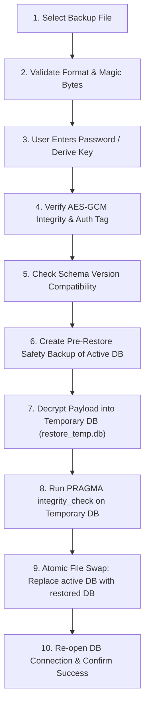

# Nexa CRM — Backup & Restore Specification

## 1. Overview
Because Nexa CRM has no cloud backend in V1, local backup and restore is the primary mechanism for disaster recovery and cross-device migration.

## 2. Backup Archive Structure
The backup file (`nexa_backup_YYYYMMDD_HHMMSS.nxbak`) contains a JSON envelope wrapping an authenticated, encrypted payload:

```json
{
  "magic": "NEXA_BACKUP",
  "version": 1,
  "appVersion": "1.0.0",
  "schemaVersion": 1,
  "createdAt": "2026-11-02T02:00:00Z",
  "kdf": {
    "algorithm": "PBKDF2-HMAC-SHA256",
    "iterations": 100000,
    "salt": "<base64_32_bytes>"
  },
  "cipher": {
    "algorithm": "AES-256-GCM",
    "iv": "<base64_12_bytes>",
    "authTag": "<base64_16_bytes>"
  },
  "payload": "<base64_encrypted_database_bytes>"
}
```

## 3. Strict 10-Step Safe Restore Protocol
To guarantee that user data is never corrupted or lost during a failed restore, the application executes the following 10 steps sequentially:



If **any** step fails:
- The active database is immediately preserved untouched.
- Any temporary database file is deleted.
- A descriptive error is returned to the user.
- Zero data loss occurs.

## 4. Retention Policy
- Automated daily backups keep:
  - 7 daily snapshots
  - 4 weekly snapshots
- Backups are stored in app-private storage, with an option to export/share via Android Sharesheet to Google Drive, Telegram, or external SD card.
