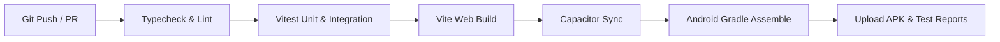

# Nexa CRM — CI/CD Pipeline

## 1. Pipeline Overview
The CI/CD pipeline runs automated quality checks on every pull request and builds signed release APK artifacts on release tags.



## 2. GitHub Actions Workflow Configuration
```yaml
name: Nexa CRM CI/CD

on:
  push:
    branches: [main]
    tags: ['v*']
  pull_request:
    branches: [main]

jobs:
  validate:
    runs-on: ubuntu-latest
    steps:
      - uses: actions/checkout@v4
      - uses: actions/setup-node@v4
        with:
          node-version: 22
          cache: 'npm'
      - run: npm ci
      - run: npm run typecheck
      - run: npm run test

  build-android:
    needs: validate
    runs-on: ubuntu-latest
    steps:
      - uses: actions/checkout@v4
      - uses: actions/setup-node@v4
        with:
          node-version: 22
      - uses: actions/setup-java@v4
        with:
          distribution: 'temurin'
          java-version: '21'
      - uses: android-actions/setup-android@v3
      - run: npm ci
      - run: npm run build
      - run: npx cap sync android
      - name: Build Android APK
        run: |
          cd android
          chmod +x gradlew
          ./gradlew assembleDebug
      - uses: actions/upload-artifact@v4
        with:
          name: nexa-debug-apk
          path: android/app/build/outputs/apk/debug/app-debug.apk
```
