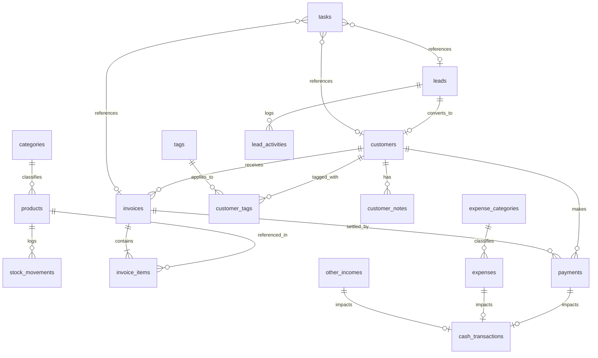

# Nexa CRM — Entity-Relationship Diagram (ERD)

## Relationship Cardinalities & Cascade Policies

1. **Category -> Products (`1:N`):**
   - `ON DELETE SET NULL`: Archiving or deleting a category leaves the product intact with null category.
2. **Product -> Stock Movements (`1:N`):**
   - `ON DELETE RESTRICT`: Products with stock history cannot be hard deleted.
3. **Invoice -> Invoice Items (`1:N`):**
   - `ON DELETE CASCADE` (only applicable for drafts; issued invoices are never deleted).
4. **Customer -> Invoices (`1:N`):**
   - `ON DELETE RESTRICT`: Customers with issued invoices cannot be hard deleted.
5. **Customer -> Notes & Tags (`1:N`, `N:M`):**
   - `ON DELETE CASCADE`: Deleting an unlinked test customer cleans up associated tags and notes.
6. **Lead -> Customer (`1:1` optional):**
   - When converted, `leads.converted_customer_id` links to the generated customer ID.
