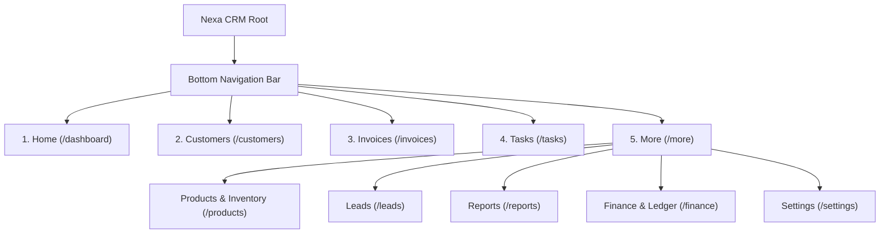

# Nexa CRM — Screen Map & Route Hierarchy

## 1. Top-Level Tab Structure (Five Bottom Navigation Items)

## 2. Complete Route Catalog

| Route Path | View / Component | Navigation Context | Presentation Mode |
|---|---|---|---|
| `/onboarding` | `OnboardingView.vue` | Standalone First Launch | Fullscreen |
| `/lock` | `LockView.vue` | Security Auth Gate | Fullscreen Modal |
| `/dashboard` | `DashboardView.vue` | Bottom Nav (Tab 1) | Main Layout |
| `/customers` | `CustomerListView.vue` | Bottom Nav (Tab 2) | Main Layout |
| `/customers/new` | `CustomerFormView.vue` | Sub-page | Focused Page (Back button) |
| `/customers/:id` | `CustomerDetailView.vue`| Sub-page | Focused Page |
| `/invoices` | `InvoiceListView.vue` | Bottom Nav (Tab 3) | Main Layout |
| `/invoices/new` | `InvoiceCreateView.vue` | Sub-page | Focused Page |
| `/invoices/:id` | `InvoiceDetailView.vue` | Sub-page | Focused Page |
| `/tasks` | `TaskListView.vue` | Bottom Nav (Tab 4) | Main Layout |
| `/more` | `MoreMenuView.vue` | Bottom Nav (Tab 5) | Main Layout |
| `/products` | `ProductListView.vue` | More Sub-section | Main Layout |
| `/products/new` | `ProductFormView.vue` | Sub-page | Focused Page |
| `/products/:id` | `ProductDetailView.vue` | Sub-page | Focused Page |
| `/inventory` | `InventoryLedgerView.vue`| More Sub-section | Main Layout |
| `/leads` | `LeadListView.vue` | More Sub-section | Main Layout |
| `/leads/:id` | `LeadDetailView.vue` | Sub-page | Focused Page |
| `/reports` | `ReportsView.vue` | More Sub-section | Main Layout |
| `/finance` | `FinanceLedgerView.vue` | More Sub-section | Main Layout |
| `/settings` | `SettingsView.vue` | More Sub-section | Main Layout |
| `/settings/backup` | `BackupRestoreView.vue`| Sub-page | Focused Page |
